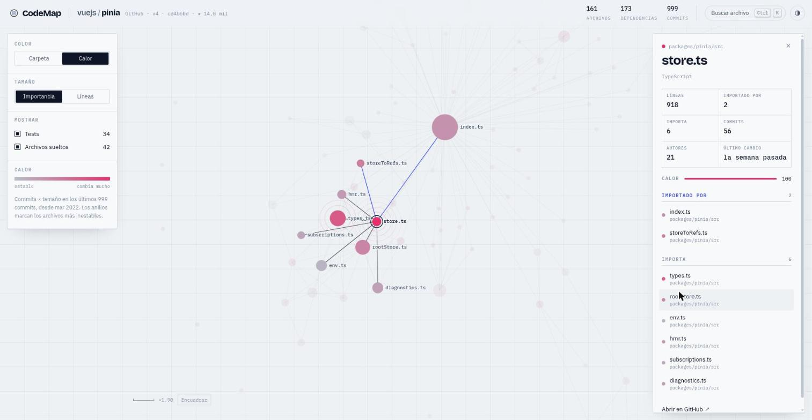
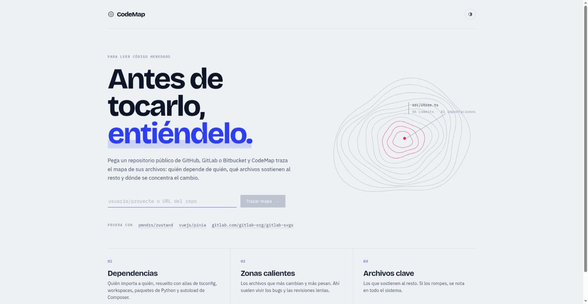
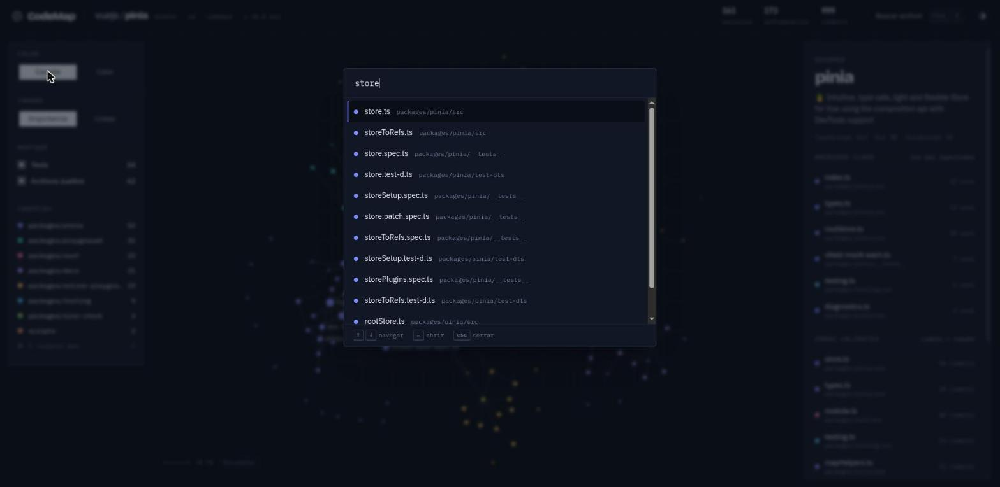

<div align="center">

# CodeMap

**Antes de tocarlo, entiéndelo.**

Pega un repositorio de GitHub, GitLab o Bitbucket y mira su código como un mapa:<br>
quién depende de quién, qué archivos sostienen al resto y dónde se concentra el cambio.

<br>


</div>

<br>

<table>
  <tr>
    <td width="50%"></td>
    <td width="50%"></td>
  </tr>
  <tr>
    <td><b>Zonas calientes.</b> Commits × tamaño. Los anillos marcan los archivos más inestables.</td>
    <td><b>Cualquier repo público.</b> <code>usuario/proyecto</code> o la URL de GitHub, GitLab o Bitbucket.</td>
  </tr>
  <tr>
    <td width="50%"></td>
    <td width="50%" valign="top">
      <br>
      <b>Lo que entiende</b>
      <br><br>
      TypeScript · JavaScript · Vue · Svelte · Python · PHP
      <br><br>
      Alias de <code>tsconfig</code>, workspaces, paquetes de Python y autoload PSR-4 de Composer.
    </td>
  </tr>
  <tr>
    <td><b>Búsqueda instantánea.</b> <kbd>Ctrl</kbd> <kbd>K</kbd> para saltar a cualquier archivo.</td>
    <td></td>
  </tr>
</table>

<br>

## Ejecutar

```bash
npm install
npm run dev
```

o con Docker:

```bash
docker build -t codemap . && docker run --rm -p 8787:8787 codemap
```

<br>

<div align="center">

React · TypeScript · d3-force · motion · Fastify · Docker

<sub>Hecho por <b>Luis Felipe Hoyos Vega</b> · MIT</sub>

</div>
